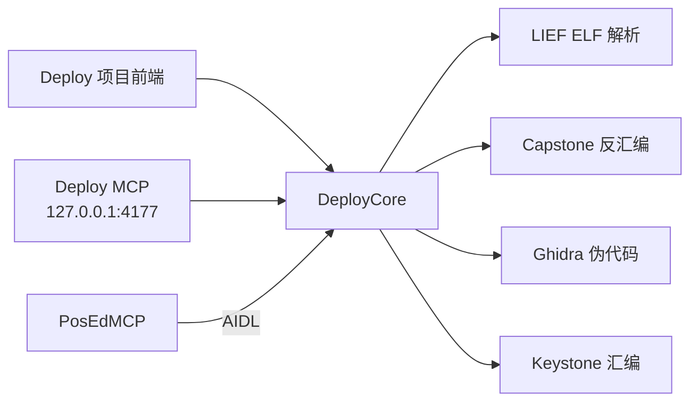

# Deploy

Deploy 是 Android 上面向 ELF、尤其是 Android Native `.so` 的二进制分析工具，
同时提供独立的 MCP 服务器。它在设备本地使用 LIEF、Capstone、Ghidra 11.3.2
和 Keystone 完成 ELF 解析、符号分析、反汇编、C 风格伪代码和机器码生成。

当前版本：**0.4.0**。Deploy 使用独立应用 UID，不声明 `sharedUserId`，自身不需要
root。与 PosEdMCP 配合时，两款应用通过 AIDL 连接；需要改变目标进程的操作仍由
PosEdMCP 的确认策略负责。

## 功能

- 项目管理器：新建项目并导入 `.so` 私有副本，避免原始文件来自可移动存储时失效。
- 三个项目页面：Decompiler、Assembler、Info & files。
- 符号树：库 → 符号 → 符号代码；库和符号都可以展开、收回，代码直接挂在对应符号下。
- 符号分析：同时读取 `.dynsym` 和 `.symtab`，支持动态/静态表选择、名称过滤和分页，
  保留重复名称及本地符号的 `(table,index)` 身份。
- 指令级反汇编：支持小端 AArch64、ARM/Thumb、x86 和 x86_64 ELF。
- C 风格伪代码：使用 Ghidra 原生引擎，目前支持小端 AArch64 ELF。
- 汇编和字节分析：使用 Keystone 生成机器码，使用 Capstone 解码字节；结果不会自动
  写入或执行。
- MCP 与 AIDL：Deploy 自己提供本地 MCP；项目界面和 PosEdMCP 都通过同一 `DeployCore`
  进入分析后端。
- `.so` 文件关联：注册 `application/x-sharedlib`，可由文件管理器交给 Deploy。

## 工作方式



Deploy 直接分析它能够读取的设备文件，例如 `/sdcard/` 下的库。它不会共享 PosEdMCP
的 UID，也不会因为 AIDL 连接而获得 root 或目标应用私有目录的读取权限。

安装 Deploy 后，打开 Settings，授予需要的文件访问权限并点击 **Start service**。
独立 MCP 端点为：

```text
http://127.0.0.1:4177/mcp
```

请求使用 Deploy Settings 页显示的 Bearer token；`/health` 只表示 HTTP 服务存活，
不代表某个文件可读或已经解析成功。完整的 Agent 使用规则见
[docs/MCP_PROMPT.md](docs/MCP_PROMPT.md)。

常用分析顺序是：先调用 `deploy_status`，再用 `deploy_analyze` 的 `overview` 确认
ELF 架构，随后按需查询 `symbols`、`resolve`、`disasm` 或 `decompile`。

```json
{
  "path": "/sdcard/libexample.so",
  "op": "symbols",
  "table": "all",
  "query": "JNI",
  "max": 100
}
```

`symbols` 的后续页通过返回的 `nextOffset` 读取。地址字段是加载前的 ELF 虚拟地址，
不是文件偏移，也不是包含 ASLR 的运行时地址。

## 与 PosEdMCP 协作

PosEdMCP 是独立的特权应用和 MCP 服务器，源代码位于另一个仓库。它可以通过 AIDL
使用 Deploy 的以下能力：

- 为指定 ELF 文件创建只读快照并分析；
- 生成汇编字节或分析内存快照；
- 将已确认的运行时请求交给 PosEdMCP 自己的目标进程桥。

运行时加载、目标进程内存读取和单条 ARM64 指令修改都属于 PosEdMCP 的工具，受其
确认闸门、作用域和目标进程检查约束。Deploy 自身不直接加载其他应用的 native 库，
不提供 root、shell 或持久 native hook。

两款应用可以单独运行：

- 只有 Deploy：继续分析可读的 `/sdcard/` 文件；提权和目标进程操作不可用。
- 只有 PosEdMCP：原有提权服务继续工作，并报告 Deploy 辅助应用不可用。
- 两者同时运行：PosEdMCP 增加 Deploy 分析和经过确认的运行时协作能力。

ColorOS / HyperOS 用户可以在 PosEdMCP 的特殊设置中启用“帮助Deploy”钩子，降低已
知后台清理路径对 Deploy 的影响。该开关默认关闭，具体 ROM 版本仍可能需要用户手动
允许后台运行或重启系统。

## 已知限制

- 伪代码是引擎推断结果，不是原始 C/C++ 源码。当前仅支持小端 AArch64。
- 伪代码默认指令预算为 20,000，允许提高到 100,000；单次默认工作期限为 30 秒，
  可指定 1–120 秒。复杂或很长的函数仍可能返回 `DECOMPILER_TIMEOUT`，此时应使用
  `disasm` 按页读取 ASM。ASM 不依赖伪代码是否成功。
- 如果 ELF 没有 `.symtab`，被剥除的内部函数名无法从 `.dynsym` 凭空恢复；
  `defined:false` 的符号是外部导入，其实现不在当前文件中。
- 线性反汇编不会恢复完整控制流，也不会验证或执行指令。汇编只表示机器码生成成功，
  不表示机器码适合写入目标进程。
- 当前不包含持久 native hook、inline/PLT hook 或 LIEF 离线改写、部署和回滚工作流。

## 构建

需要：

- JDK 17 或更高版本；
- Android SDK 36；
- Android NDK 28.2.13676358；
- CMake 3.22.1；
- Gradle 8.14.3；
- `third_party/README.md` 中列出的固定版本依赖。

先准备依赖，并运行 `tools/prepare-ghidra.py` 生成 Ghidra 语言资产。然后在仓库根目录
创建不纳入 Git 的 `local.properties`：

```properties
sdk.dir=E\:/SDK
```

Linux / Git Bash：

```bash
bash tools/bootstrap-gradle.sh
bash tools/gradle.sh :deploy:assembleDebug :native-fixture:assembleDebug
```

PowerShell：

```powershell
$env:JAVA_HOME = 'C:/Program Files/Java/jdk-22'
$env:GRADLE_USER_HOME = "$PWD/.gradle-home"
& ./.tools/gradle-8.14.3/bin/gradle.bat :deploy:assembleDebug :native-fixture:assembleDebug
```

APK 输出为：

```text
deploy/build/outputs/apk/debug/deploy-debug.apk
native-fixture/build/outputs/apk/debug/native-fixture-debug.apk
```

Deploy 当前打包 `arm64-v8a`。APK 的 ABI 与它能够解析的 ELF 架构是两个独立概念。
`native-fixture` 仅用于集成测试，无需随 Deploy 安装。

## 仓库结构

| 路径 | 作用 |
| --- | --- |
| `deploy/` | `dev.deploy` APK、项目界面、MCP 服务、AIDL 服务和 native 后端 |
| `deploy-api/` | AIDL 与分析参数契约的维护源 |
| `native-fixture/` | `dev.deploy.fixture` 测试 APK 及测试库 |
| `docs/MCP_PROMPT.md` | 连接 Deploy 的 Agent 使用规则 |
| `docs/DEPLOY-NATIVE.md` | 原生后端、跨应用接口和真机验收说明 |
| `tools/deploy-analysis-regression.py` | 符号分页和长函数分析回归测试 |
| `tools/deploy-smoke.py` | 两款应用的集成与隔离测试 |
| `tools/deploy-engines-smoke.py` | 反汇编、伪代码、内存快照和补丁恢复测试 |
| `tools/prepare-ghidra.py` | 生成 Ghidra SLEIGH 语言资产 |
| `third_party/` | 固定版本依赖、补丁和准备说明 |

修改 `deploy-api/` 后，需要将相同的契约文件同步到 PosEdMCP，并分别构建两端。具体
规则见 [deploy-api/README.md](deploy-api/README.md)。

## 文档与验证

- [当前设计与进度](DESIGN.md)
- [原生分析与跨应用接口](docs/DEPLOY-NATIVE.md)
- [MCP 提示词](docs/MCP_PROMPT.md)
- [0.4.0 里程碑](MILESTONE-0.4.md)
- [ColorOS / HyperOS 相关验收](MILESTONE-COLOROS.md)
- [符号分析与项目树回归记录](docs/ANALYSIS-UX-REGRESSION.md)

测试库和真机日志不会提交到仓库。每轮工作完成后整理 Git 并创建本地提交；默认不
自动推送到远程仓库。

本项目尚未选择项目许可证；第三方库分别遵循其上游许可证。
